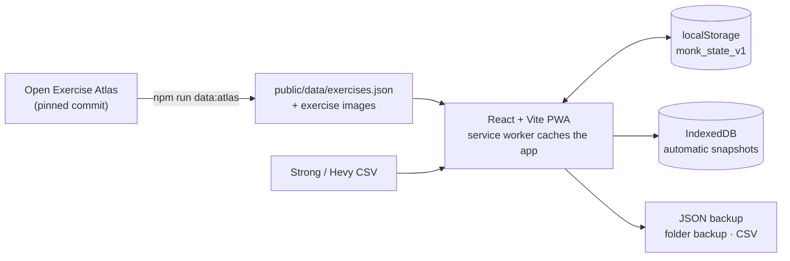

<div align="center">
  
  <h1>monk-mode</h1>
  <p><strong>Pain is inevitable. Suffering is a choice.</strong></p>
  <p>An offline-first workout tracker with no account and no server.<br />Your training log lives in your browser.</p>
  <p>
    <a href="https://yagizerentunay.github.io/monk-mode/"><strong>Open the live app →</strong></a>
    · <a href="#features">Features</a>
    · <a href="#development">Development</a>
    · <a href="README.tr.md">Türkçe</a>
  </p>
  <p>
    <a href="https://github.com/yagizerentunay/monk-mode/actions/workflows/pages.yml"></a>
    <a href="https://github.com/yagizerentunay/monk-mode/releases"></a>
    <a href="LICENSE"></a>
    
  </p>
</div>

<p align="center">
  
</p>

> [!NOTE]
> The app interface is in Turkish. Screenshots use generated sample data (`npm run screenshots`).

## Why monk-mode

- **No account, no server.** Nothing to sign up for; the app is a static site and your data never leaves the device.
- **Works offline.** Install it to your home screen and log sets in a basement gym with no signal.
- **Built for progressive overload.** Every set pre-fills from last time, and the app tells you when to add weight and why.
- **Open exercise data.** The illustrated library is generated from [Open Exercise Atlas](https://github.com/yagizerentunay/open-exercise-atlas), not scraped.

## Screenshots

<table>
  <tr>
    <td align="center"><br /><sub><b>Home</b> · today's routine and streak</sub></td>
    <td align="center"><br /><sub><b>Workout</b> · warm-ups, RIR, rest timer</sub></td>
    <td align="center"><br /><sub><b>Records</b> · best e1RM and longest holds</sub></td>
  </tr>
  <tr>
    <td align="center"><br /><sub><b>Consistency</b> · 16-week heatmap</sub></td>
    <td align="center"><br /><sub><b>Muscle map</b> · sets per muscle</sub></td>
    <td align="center"><br /><sub><b>Library</b> · illustrated, filterable</sub></td>
  </tr>
</table>

<details>
<summary>More screenshots</summary>
<br />
<table>
  <tr>
    <td align="center"><br /><sub><b>Analysis</b> · e1RM over time</sub></td>
    <td align="center"><br /><sub><b>Templates</b> · beginner programs</sub></td>
  </tr>
</table>
</details>

## Features

| | |
|---|---|
| **[Plan](docs/features.md#planla)** | Routine builder and weekly schedule · beginner templates (Full Body, Upper/Lower, PPL) · copy routines · share routines by link or QR (no server) · 4–6 week training blocks with a planned deload week · illustrated exercise library with muscle and equipment filters · custom exercises and muscle corrections |
| **[Train](docs/features.md#antrenman)** | Sets pre-filled from last session · quick RIR entry · warm-up ramps, drop sets and supersets · unilateral (L/R), timed and distance (cardio) sets · per-exercise rest timer · plate calculator · free workouts · notes · shareable summary card (PNG) · screen stays awake |
| **[Progress](docs/features.md#ilerleme)** | Linear and double progression with a cautious RIR-based rule · estimated 1RM chart · 1RM goals with a projected arrival date · personal records · weekly volume · frequency heatmap · muscle map with weekly targets · bodyweight trend with a goal rate · body measurements (waist, chest, arm, hip, body fat %) · deload hint · calendar with backdated logging and history editing |
| **[Data safety](docs/features.md#veri-guvenligi)** | JSON backup and restore · backup reminders · automatic snapshots in IndexedDB · daily backups to a folder (desktop Chrome/Edge) · merge a backup from another device · undo delete · recovery screen for corrupted data |
| **[Import & export](docs/features.md#ice-disa-aktarma)** | Strong and Hevy CSV import (including Turkish Hevy exports) · CSV export for Excel, including distance sets and body measurements |
| **[App](docs/features.md#uygulama)** | Installable PWA · works offline · light, dark or system theme · new-version banner · diagnostics card |

The full, detailed guide is in [docs/features.md](docs/features.md) (Turkish).

## How it works



- **No backend.** The app is a static bundle on GitHub Pages. State is a single object in `localStorage`; every load validates it record by record.
- **Exercise data is generated, not hand-edited.** `data/atlas.lock.json` pins an Atlas commit and file hashes; `npm run data:atlas` rebuilds the catalog. See [docs/atlas-data.md](docs/atlas-data.md).
- **Offline by design.** A hand-written service worker (`public/sw.js`) precaches the app shell and catalog; exercise images are cached as you view them.

## Your data

- Data is stored only in this browser. There is no account, sync or server.
- Clearing browser data can delete your log. Download a backup from **Settings** and keep it somewhere safe.
- On desktop Chrome/Edge you can pick a folder for daily automatic backups; if that folder syncs to OneDrive or Drive, your backups reach the cloud too.
- On iPhone, add the app to the home screen: home-screen apps are protected from Safari's storage cleanup. Take a backup first, because the home-screen app has separate storage.
- Each device and browser keeps its own data. Move it with a backup file, or merge two devices' backups in **Settings**.

## Development

Requires Node.js 22 or newer.

```bash
npm install
npm run dev
```

The dev server opens at `http://localhost:5173`.

| Command | What it does |
|---|---|
| `npm run dev` | Start the dev server |
| `npm test` | Run unit tests (Vitest) |
| `npm run test:e2e` | Run end-to-end tests (Playwright, mobile Chrome); the first run needs `npx playwright install chromium` |
| `npm run lint` | Lint with oxlint |
| `npm run build` | Type-check and build for production |
| `npm run screenshots` | Regenerate the README screenshots and demo GIF from sample data (the GIF needs `ffmpeg`) |
| `npm run data:atlas` | Rebuild the exercise catalog from Open Exercise Atlas (`:update` re-pins, `:check` verifies the outputs are current) |

### Try the offline build

The service worker does not run on the dev server. To test the production build locally:

```bash
npm run build
npm run preview
```

Open `http://localhost:4173` once; after that the app loads even with the server stopped. If you change the cache layout, bump `VERSION` in `public/sw.js`.

### GitHub Pages

Every push to `main` runs the [Pages workflow](.github/workflows/pages.yml): unit tests, lint, end-to-end tests and a production build, then deploys. Pages must be set to **Source: GitHub Actions**.

## Credits

- Product ideas inspired by [openGym](https://github.com/DuarteSantos8/openGym). monk-mode is written from scratch and contains no openGym code.
- Exercise names, muscles, instructions and illustrations come from [Open Exercise Atlas](https://github.com/yagizerentunay/open-exercise-atlas).

## License

[MIT](LICENSE)
