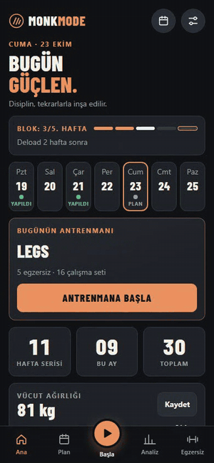
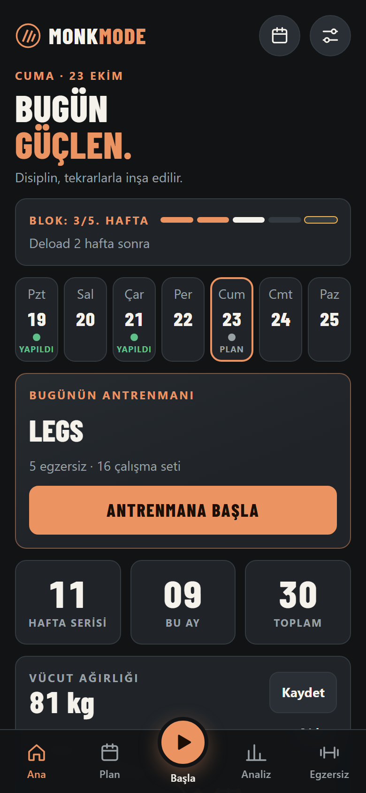
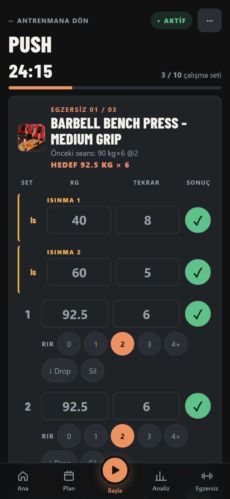
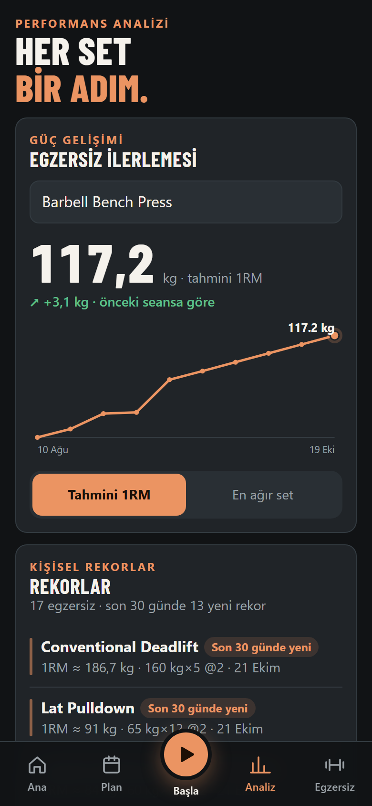
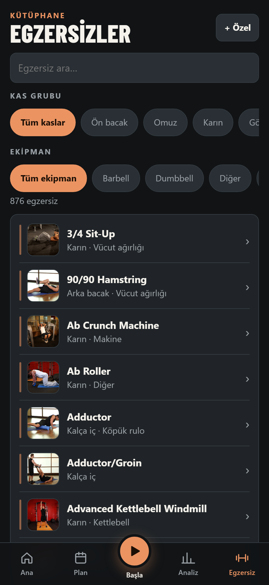

<div align="center">
  
  <h1>monk-mode</h1>
  <p><strong>Pain is inevitable. Suffering is a choice.</strong></p>
  <p>Hesapsız, sunucusuz ve çevrimdışı çalışabilen antrenman günlüğün.</p>
  <p>
    <a href="https://yagizerentunay.github.io/monk-mode/"><strong>Canlı demoyu aç →</strong></a>
    · <a href="#özellikler">Özellikleri keşfet</a>
    · <a href="#kurulum">Geliştirmeye başla</a>
  </p>
  <p>
    <a href="https://github.com/yagizerentunay/monk-mode/actions/workflows/pages.yml"></a>
    <a href="LICENSE"></a>
    
  </p>
</div>

---

## Antrenmanını takip et. Verin sende kalsın.

Rutinlerini planla, setlerini kaydet ve ilerlemeni gör. Monk Mode hesabı, bulut eşitlemesi veya sunucu kullanmaz: verilerin bu tarayıcıda saklanır. Verini düzenli olarak **Ayarlar → Yedeği indir** ile dışa aktarabilirsin.

<p align="center">
  
  <br />
  <sub>Antrenmanda set tamamla, RIR gir, ilerlemeni gör. Örnek verilerle kaydedilmiştir.</sub>
</p>

Uygulama [openGym](https://github.com/DuarteSantos8/openGym)'den ürün fikri olarak esinlenir; kodu sıfırdan yazılmıştır ve openGym kodu içermez.

## Özellikler

| Planla | Antrenman yap | İlerlemeni gör |
|---|---|---|
| Rutin oluşturucu, başlangıç şablonları (Full Body, Upper/Lower, PPL), haftalık program ve egzersiz kütüphanesi | Önceki setlerden otomatik doldurma, dinlenme sayacı, ısınma, dropset ve süperset | Tahmini 1RM, kişisel rekorlar, antrenman geçmişi ve takvim |
| Kas ve ekipman filtreleri; egzersizleri özelleştirme | RIR, tek taraflı egzersizler ve plaka hesaplayıcı | Kas haritası, haftalık hedefler ve vücut ağırlığı trendi |
| Strong ve Hevy CSV içe aktarma | Antrenman ve egzersiz notları | Otomatik kopyalar ve tek dokunuşla yedek |

[Tüm özelliklerin ayrıntıları →](docs/features.md)

## Ekran görüntüleri

<p align="center">
  
  
</p>
<p align="center">
  
  
</p>

Üstte ana ekran ve antrenman, altta analiz ve egzersiz kütüphanesi. Görüntüler örnek verilerle alınmıştır.

## Egzersiz verisi

Egzersiz kütüphanesi (adlar, kaslar, ekipman, yönergeler ve görseller) elle yazılmaz; [Open Exercise Atlas](https://github.com/yagizerentunay/open-exercise-atlas) deposundan, sabitlenmiş bir commit'ten üretilir. Egzersiz eklemek ya da düzeltmek için Atlas'ı değiştir, `npm run data:atlas:update` çalıştır ve çıktıyı commit'le. Ayrıntılar: [docs/atlas-data.md](docs/atlas-data.md).

## Verin ve çevrimdışı kullanım

- Veriler yalnızca kullandığın tarayıcının `localStorage` alanında saklanır. Hesap, bulut eşitlemesi veya sunucu yoktur.
- Masaüstü Chrome/Edge'de Ayarlar'dan bir klasör seçersen yedek her değişiklikte o klasöre yazılır; klasör OneDrive/Drive gibi eşitleniyorsa yedeğin buluta da gider. iPhone'da ise ana ekrana ekle ve yedek al: ana ekran uygulamasının verisi tarayıcı temizliğinden korunur.
- Tarayıcı verilerini silmek kayıtlarını da silebilir. Yedeklerini düzenli indir ve güvenli bir yerde sakla.
- Uygulama çevrimdışı açılır; egzersiz görsellerinden yalnızca daha önce görüntülediklerin önbelleğe alınır.
- Her cihaz ve tarayıcı kendi verisini tutar. Cihazlar arasında taşımak için bir cihazda yedek alıp diğerinde içe aktar.

## Kurulum

Node.js 22 veya üstü gerekir.

```bash
npm install
npm run dev
```

Geliştirme sunucusu `http://localhost:5173` adresinde açılır.

### Kontroller

| Komut | Açıklama |
|---|---|
| `npm run dev` | Geliştirme sunucusunu başlatır |
| `npm test` | Birim testlerini çalıştırır |
| `npm run test:e2e` | Uçtan uca testleri (Playwright, mobil Chrome) çalıştırır; ilk seferde `npx playwright install chromium` gerekir |
| `npm run lint` | Kod denetimini çalıştırır |
| `npm run build` | Tür kontrolü ve üretim derlemesi yapar |
| `npm run data:atlas` | Egzersiz kataloğunu [Open Exercise Atlas](https://github.com/yagizerentunay/open-exercise-atlas)'tan yeniden üretir (`:update` pini yeniler, `:check` çıktıların güncel olduğunu doğrular; bkz. [docs/atlas-data.md](docs/atlas-data.md)) |

### Çevrimdışı derlemeyi dene

Service worker geliştirme sunucusunda çalışmaz. Üretim derlemesini yerelde denemek için:

```bash
npm run build
npm run preview
```

`http://localhost:4173` adresini bir kez açtıktan sonra uygulama sunucu kapalıyken de yüklenir. Önbellek şemasını değiştirirsen `public/sw.js` içindeki `VERSION` değerini artır.

### GitHub Pages

`main` dalına push edildiğinde [Pages iş akışı](.github/workflows/pages.yml) testleri, lint'i ve üretim derlemesini çalıştırıp uygulamayı yayımlar. GitHub Pages ayarında **Source: GitHub Actions** seçili olmalıdır.

Canlı uygulama: **[yagizerentunay.github.io/monk-mode](https://yagizerentunay.github.io/monk-mode/)**

## Lisans

[MIT](LICENSE)
