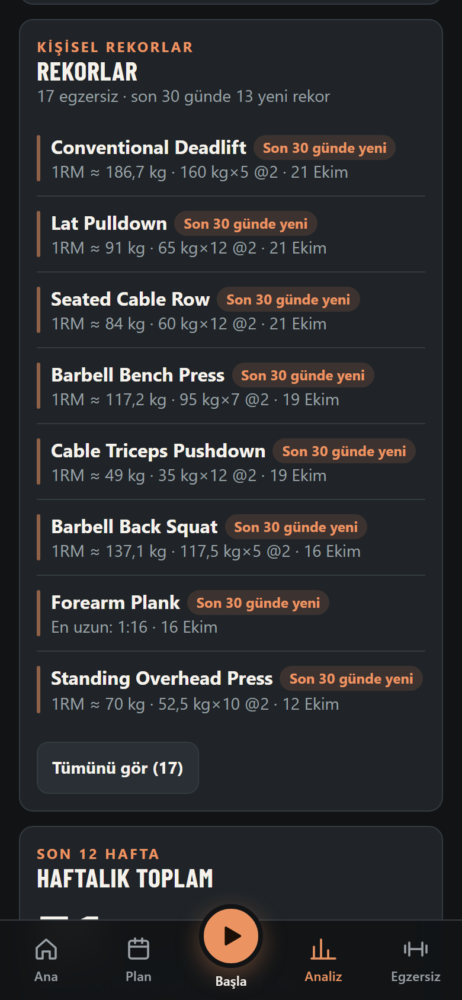
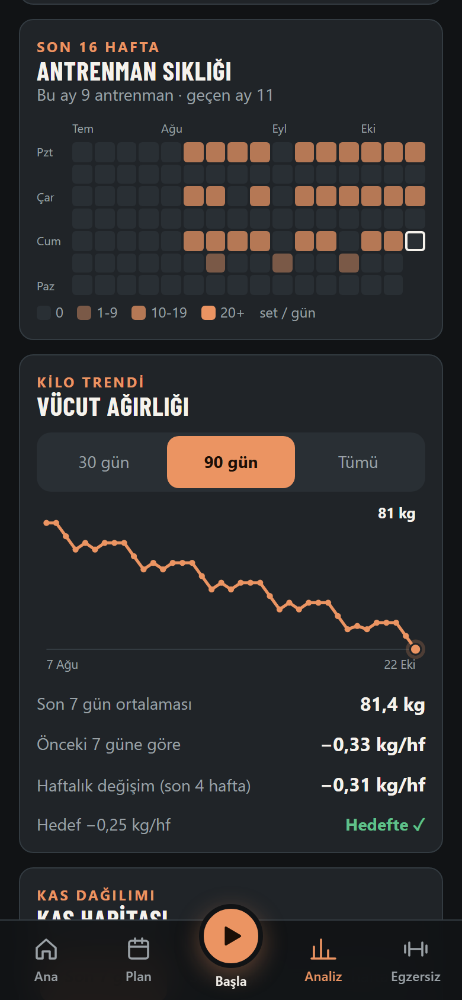
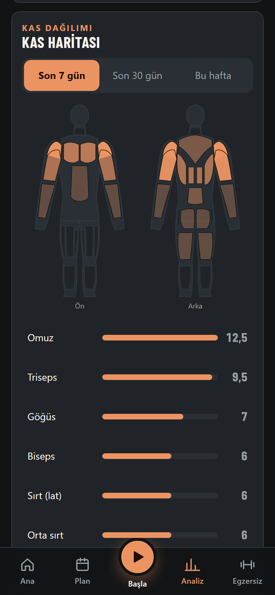
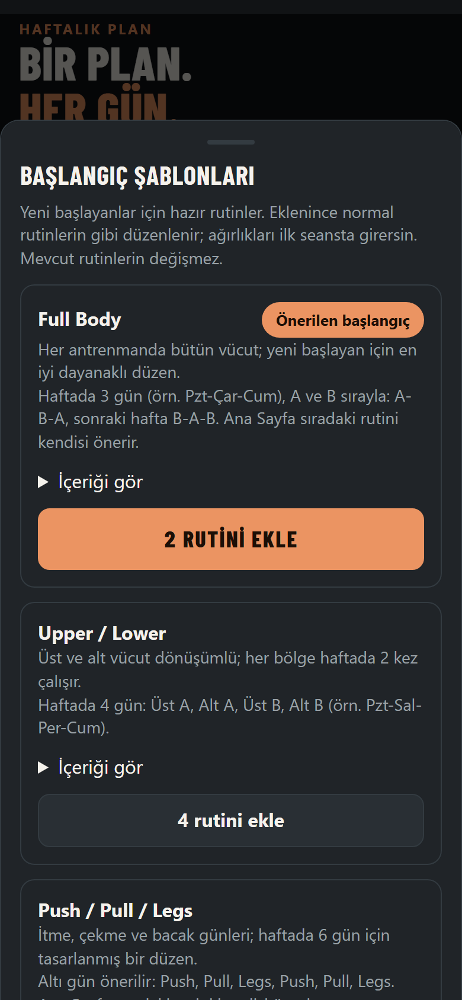
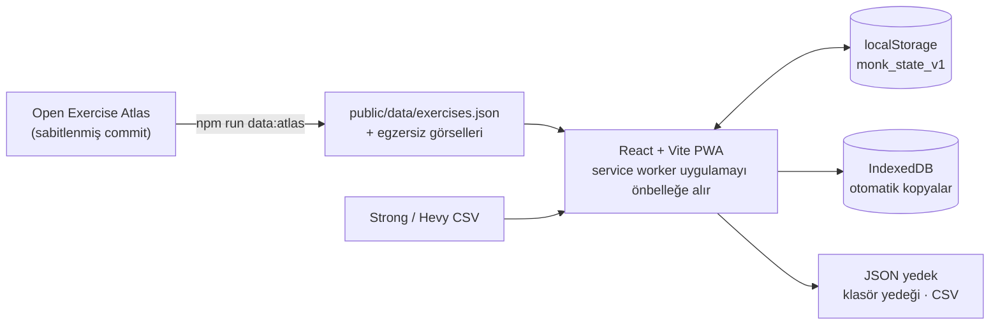

<div align="center">
  
  <h1>monk-mode</h1>
  <p><strong>Pain is inevitable. Suffering is a choice.</strong></p>
  <p>Hesapsız, sunucusuz ve çevrimdışı çalışan antrenman günlüğün.<br />Kayıtların tarayıcında kalır.</p>
  <p>
    <a href="https://yagizerentunay.github.io/monk-mode/"><strong>Uygulamayı aç →</strong></a>
    · <a href="#özellikler">Özellikler</a>
    · <a href="#geliştirme">Geliştirme</a>
    · <a href="README.md">English</a>
  </p>
  <p>
    <a href="https://github.com/yagizerentunay/monk-mode/actions/workflows/pages.yml"></a>
    <a href="https://github.com/yagizerentunay/monk-mode/releases"></a>
    <a href="LICENSE"></a>
    
  </p>
</div>

<p align="center">
  
</p>

> [!NOTE]
> Görüntüler örnek verilerle üretilmiştir (`npm run screenshots`).

## Neden monk-mode

- **Hesap yok, sunucu yok.** Kayıt olmazsın; uygulama statik bir sitedir ve verin cihazdan çıkmaz.
- **Çevrimdışı çalışır.** Ana ekrana ekle, çekmeyen bodrum salonunda bile set kaydet.
- **İlerleme için tasarlandı.** Her set son seanstan dolar; uygulama ağırlığı ne zaman ve neden artıracağını söyler.
- **Açık egzersiz verisi.** Resimli kütüphane [Open Exercise Atlas](https://github.com/yagizerentunay/open-exercise-atlas)'tan üretilir.

## Ekran görüntüleri

<table>
  <tr>
    <td align="center"><br /><sub><b>Ana ekran</b> · bugünün rutini ve seri</sub></td>
    <td align="center"><br /><sub><b>Antrenman</b> · ısınma, RIR, dinlenme</sub></td>
    <td align="center"><br /><sub><b>Rekorlar</b> · en iyi 1RM ve en uzun tutuş</sub></td>
  </tr>
  <tr>
    <td align="center"><br /><sub><b>Süreklilik</b> · 16 haftalık ısı haritası</sub></td>
    <td align="center"><br /><sub><b>Kas haritası</b> · kas başına set</sub></td>
    <td align="center"><br /><sub><b>Kütüphane</b> · resimli, filtreli</sub></td>
  </tr>
</table>

<details>
<summary>Diğer ekranlar</summary>
<br />
<table>
  <tr>
    <td align="center"><br /><sub><b>Analiz</b> · zamanla tahmini 1RM</sub></td>
    <td align="center"><br /><sub><b>Şablonlar</b> · başlangıç programları</sub></td>
  </tr>
</table>
</details>

## Özellikler

| | |
|---|---|
| **[Planla](docs/features.md#planla)** | Rutin oluşturucu ve haftalık program · başlangıç şablonları (Full Body, Upper/Lower, PPL) · rutin kopyalama · kas ve ekipman filtreli resimli kütüphane · özel egzersiz ve kas düzeltme |
| **[Antrenman yap](docs/features.md#antrenman)** | Son seanstan dolan setler · hızlı RIR girişi · ısınma rampası, dropset ve süperset · tek taraflı (sol/sağ) ve süreli setler · egzersize özel dinlenme · plaka hesaplayıcı · serbest antrenman · notlar · ekran açık kalır |
| **[İlerlemeni gör](docs/features.md#ilerleme)** | Doğrusal ve çift ilerleme, RIR'e dayalı temkinli artış kuralı · tahmini 1RM grafiği · kişisel rekorlar · haftalık hacim · sıklık ısı haritası · haftalık hedefli kas haritası · hedef hızlı kilo trendi · toparlanma önerisi · takvim, geçmişe kayıt ve geçmişi düzenleme |
| **[Veri güvenliği](docs/features.md#veri-guvenligi)** | JSON yedek ve geri yükleme · yedek hatırlatması · IndexedDB'de otomatik kopyalar · klasöre günlük yedek (masaüstü Chrome/Edge) · başka cihazın yedeğiyle birleştirme · silmeyi geri alma · bozuk veride kurtarma ekranı |
| **[İçe / dışa aktarma](docs/features.md#ice-disa-aktarma)** | Strong ve Hevy CSV içe aktarma (Türkçe Hevy dahil) · Excel için CSV |
| **[Uygulama](docs/features.md#uygulama)** | Ana ekrana eklenebilir PWA · çevrimdışı çalışma · yeni sürüm bandı · tanılama kartı |

Her özelliğin ayrıntısı: [docs/features.md](docs/features.md).

## Nasıl çalışır



- **Sunucu yok.** Uygulama GitHub Pages'te statik bir pakettir. Durum `localStorage`'da tek bir nesnedir; her açılışta kayıt kayıt doğrulanır.
- **Egzersiz verisi elle yazılmaz.** `data/atlas.lock.json` bir Atlas commit'ini ve dosya özetlerini sabitler; `npm run data:atlas` kataloğu yeniden üretir. Ayrıntı: [docs/atlas-data.md](docs/atlas-data.md).
- **Baştan çevrimdışı.** Elle yazılmış service worker (`public/sw.js`) uygulama kabuğunu ve kataloğu önbelleğe alır; egzersiz görselleri görüntülendikçe önbelleğe girer.

## Verin

- Veriler yalnızca bu tarayıcıda saklanır. Hesap, bulut eşitlemesi veya sunucu yoktur.
- Tarayıcı verisini silmek kayıtlarını da silebilir. **Ayarlar**'dan yedek indir ve güvenli bir yerde sakla.
- Masaüstü Chrome/Edge'de günlük otomatik yedek için bir klasör seçebilirsin; klasör OneDrive ya da Drive ile eşitleniyorsa yedeğin buluta da gider.
- iPhone'da uygulamayı ana ekrana ekle: ana ekran uygulamaları Safari'nin depolama temizliğinden korunur. Ana ekran uygulamasının depolaması ayrı olduğu için önce yedek al.
- Her cihaz ve tarayıcı kendi verisini tutar. Yedek dosyasıyla taşı ya da **Ayarlar**'dan iki cihazın yedeğini birleştir.

## Geliştirme

Node.js 22 veya üstü gerekir.

```bash
npm install
npm run dev
```

Geliştirme sunucusu `http://localhost:5173` adresinde açılır.

| Komut | Açıklama |
|---|---|
| `npm run dev` | Geliştirme sunucusunu başlatır |
| `npm test` | Birim testlerini çalıştırır (Vitest) |
| `npm run test:e2e` | Uçtan uca testleri çalıştırır (Playwright, mobil Chrome); ilk seferde `npx playwright install chromium` gerekir |
| `npm run lint` | oxlint ile kod denetimi |
| `npm run build` | Tür kontrolü ve üretim derlemesi |
| `npm run screenshots` | README ekran görüntülerini ve demo GIF'ini örnek veriyle yeniden üretir (GIF için `ffmpeg` gerekir) |
| `npm run data:atlas` | Egzersiz kataloğunu Open Exercise Atlas'tan yeniden üretir (`:update` pini yeniler, `:check` çıktıların güncel olduğunu doğrular) |

### Çevrimdışı derlemeyi dene

Service worker geliştirme sunucusunda çalışmaz. Üretim derlemesini yerelde denemek için:

```bash
npm run build
npm run preview
```

`http://localhost:4173` adresini bir kez açtıktan sonra uygulama sunucu kapalıyken de yüklenir. Önbellek düzenini değiştirirsen `public/sw.js` içindeki `VERSION` değerini artır.

### GitHub Pages

`main`'e her push [Pages iş akışını](.github/workflows/pages.yml) çalıştırır: birim testler, lint, uçtan uca testler ve üretim derlemesi, ardından yayın. Pages ayarında **Source: GitHub Actions** seçili olmalıdır.

## Teşekkürler

- Ürün fikri [openGym](https://github.com/DuarteSantos8/openGym)'den esinlenir. monk-mode sıfırdan yazılmıştır ve openGym kodu içermez.
- Egzersiz adları, kasları, yönergeleri ve görselleri [Open Exercise Atlas](https://github.com/yagizerentunay/open-exercise-atlas)'tandır.

## Lisans

[MIT](LICENSE)
